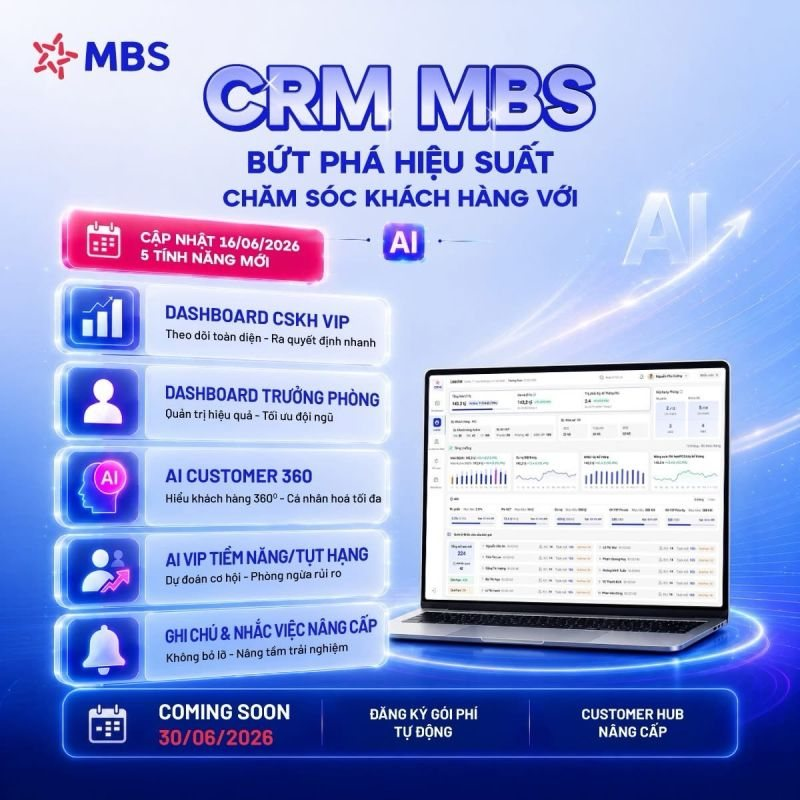
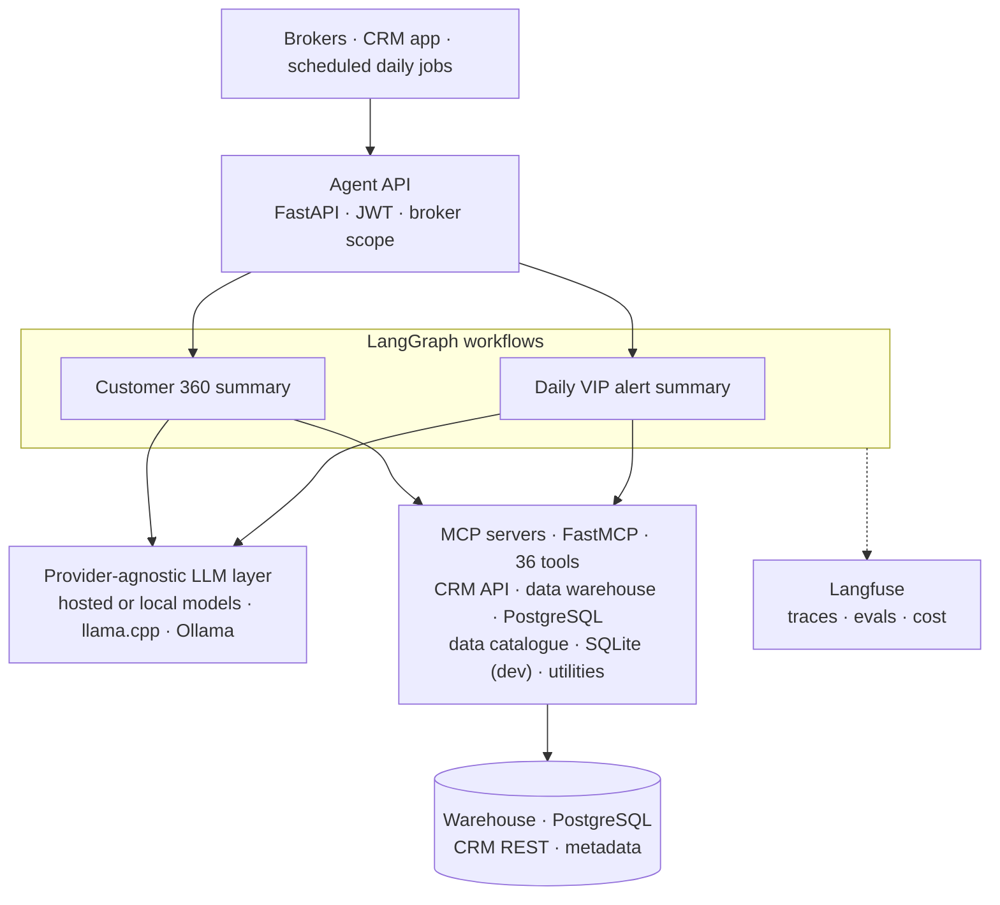
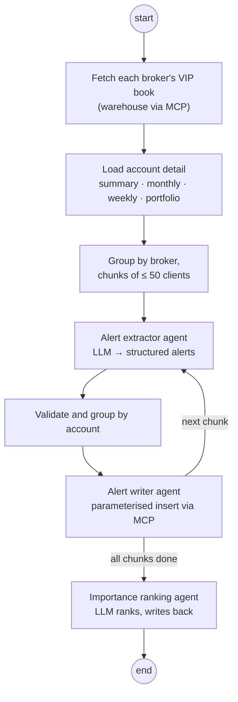
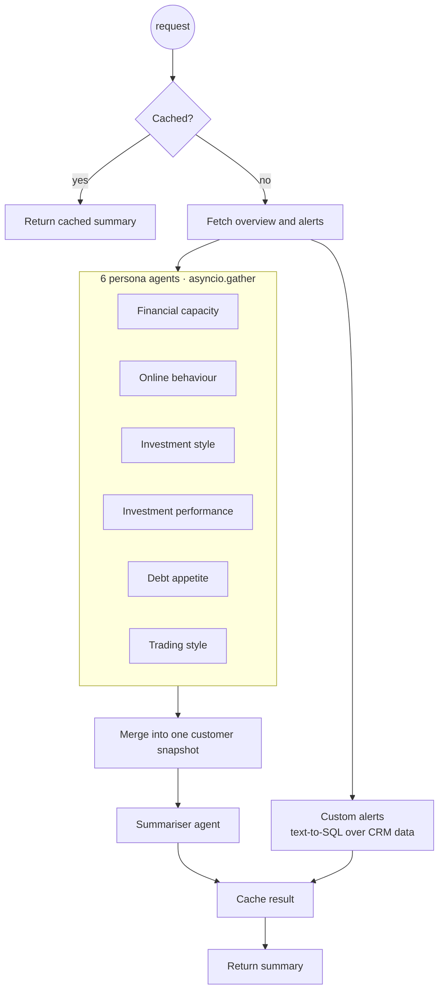

# CRM AI Platform: on-premise agents over MCP

**MB Securities (MBS), Hanoi · 2025 – 2026 · AI integration lead for a 30+ person programme**

The CRM AI platform gives **600+ MBS brokers** agentic intelligence about their **24,000 VIP clients**: daily alerts on their VIP book, and a 360° summary of any customer on demand. It runs on MBS's own servers, because client financial data has to stay under MBS's control. I set the AI integration approach for the programme, built the reference LangGraph workflow the team followed, and designed the MCP layer that connects agents to company data.

> The source code belongs to MB Securities and is not public. This repository describes the architecture and the patterns I introduced, at the level I can share. Ports, schemas, table names and credentials are left out.

## Launch

On **16 June 2026** MBS launched five new CRM features for its brokers, moving the CRM from a management tool to an AI-native platform:

- **AI Customer 360:** an AI-written profile of any client (investment behaviour, relationship history, current risks, next best actions) in **under 30 seconds**
- **AI VIP potential / at-risk detection:** ML models flag churn risk or VIP upgrade eligibility **2–3 weeks ahead**
- VIP client care dashboard, branch manager dashboard, and smarter notes and reminders

Under the hood: LangGraph, LLMs, an XGBoost churn model, RAG with pgvector, FastAPI, Redis and NiFi ETL, all inside MBS's controlled infrastructure.

 

## At a glance

| | |
|---|---|
| Launched | **16 June 2026**, five AI features for the broker network |
| Broker productivity | **+75%** |
| Scale | **24,000** VIP clients, **600+** brokers |
| Team | **30+** people across the programme |
| AI Customer 360 | **< 30 s** per client |
| Early warning | **2–3 weeks** ahead on churn and VIP upgrades |
| MCP servers | **6** (FastMCP, one per data source) |
| MCP tools | **36** |
| LangGraph workflows | **2** |
| Agents | **9**, including 6 persona agents that run in parallel |
| Observability | Langfuse tracing, evaluation and cost per workflow |
| Deployment | On-premise |

## Architecture

### Workflow 1: daily VIP alert summary

Every day, the system scans each broker's VIP clients, uses an LLM to spot what needs attention, stores the alerts, and ranks them so the broker sees the most important first.

### Workflow 2: customer 360 summary

On demand, a broker gets one readable profile of a client, built from six angles at once.

## Patterns I introduced

**Agents never open a database connection.** Every read and write goes through an MCP server over HTTP. Agents stay small, data sources can change without touching agent code, and each server can be secured, scaled and released on its own.

**One MCP server per data source.** Each server is built with a factory function, separate from the function that starts its HTTP listener, so tests can create a server without a network. Drivers and config are injected, so unit tests mock them.

**Safe SQL by default.** Read-only queries with statement classification (multi-statement input is split and each statement checked), parameterised inserts and updates, identifier validation, row limits, and error details masked at the boundary in production.

**Parallel persona agents.** Six independent analyses run concurrently with `asyncio.gather` and merge into one typed snapshot, which is cached so repeat requests are cheap.

**Model tiering behind one interface.** A single `generate_json` style call over hosted and local providers (llama.cpp, Ollama), chosen per workflow in config, with JSON-schema output so downstream nodes always get valid structures.

**Reusable templates.** The MCP servers ship as templates, so other applications across MBS connect to company data the same way.

## What I built

- The AI integration approach for the 30+ person programme
- The reference LangGraph agent workflow: orchestration, state management, parallel execution and model tiering
- The MCP connectivity layer over the data warehouse, CRM APIs and PostgreSQL, plus reusable templates
- Langfuse tracing, evaluation and cost observability

## Stack

Python ≥ 3.11 · uv · LangGraph · LangChain · FastMCP · FastAPI · Redis · pgvector · XGBoost · NiFi · SQLAlchemy 2 · psycopg 3 · pyodbc · httpx (HTTP/2) · Pydantic · DataHub (GraphQL) · llama.cpp · Ollama · Langfuse · unittest / IsolatedAsyncioTestCase

---

**Duc Quang (Cillian) Nguyen** · AI Engineer, Sydney · [Portfolio](https://quangcodecode.github.io) · [LinkedIn](https://www.linkedin.com/in/duc-quang-ng) · [dquangforwork@gmail.com](mailto:dquangforwork@gmail.com) · +61 422 475 168
